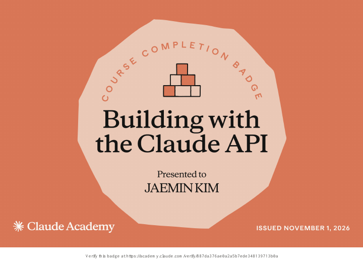
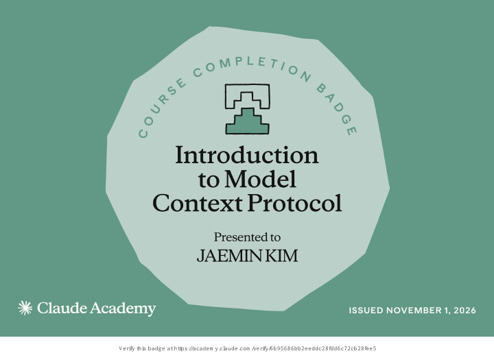
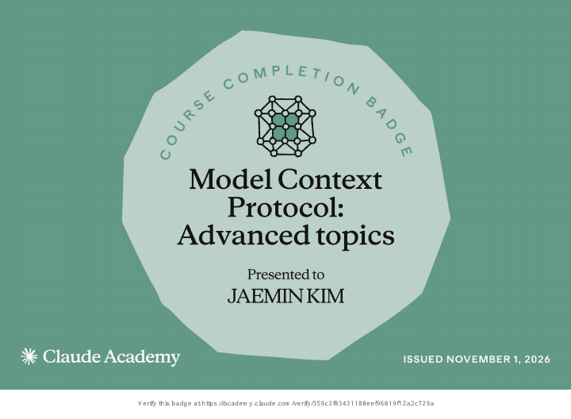

# JAEMIN KIM

## Course Completions

Claude Academy · Issued November 1, 2026

  
  
  

- [Building with the Claude API](https://academy.claude.com/verify/887da376ae0a2a5b7ede348139713b0a)
- [Introduction to Model Context Protocol](https://academy.claude.com/verify/6b95686bb2eeddc28fdd6c72cb28fee5)
- [Model Context Protocol: Advanced topics](https://academy.claude.com/verify/359c3f83431180eef96019f12a2c729a) — legacy curriculum, based on MCP before the July 28, 2026 revision.

These are course completion badges, not professional certifications.
